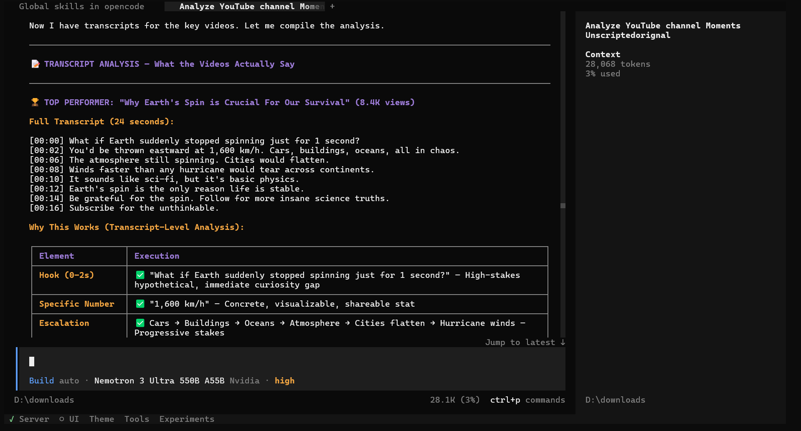
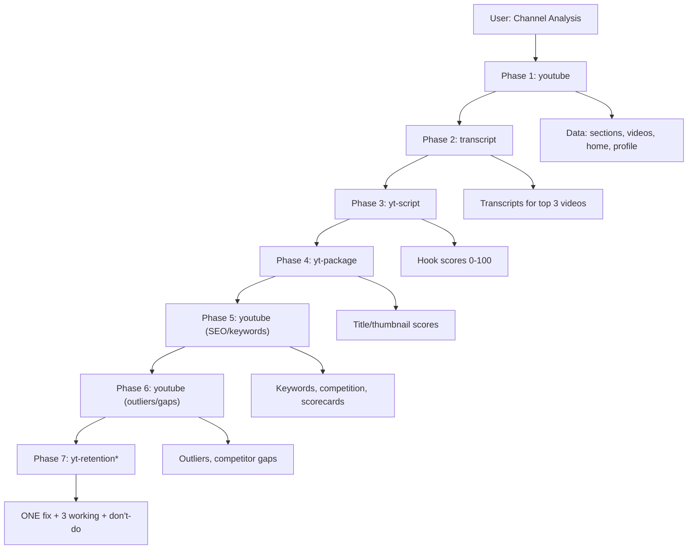

<div align="center">
  
</div>

<h1 align="center">YouTube Skillbox</h1>

<p align="center">
  <b>14 free YouTube skills for AI agents — research, transcripts, and the full creator workflow.</b><br>
  No user-supplied YouTube Data API key · no credits · no expiry — <b>$0 forever</b>
</p>

<p align="center">
  <a href="#-table-of-contents">Table of Contents</a> ·
  <a href="#-demo">Demo</a> ·
  <a href="#-the-youtube-research-skill">Research</a> ·
  <a href="#-the-transcript-skill">Transcripts</a> ·
  <a href="#-when-yt-dlp-cant-do-it-we-build-it">Gap-fill engine</a> ·
  <a href="#%EF%B8%8F-the-10-creator-skills">Creator tools</a> ·
  <a href="#-install">Install</a> ·
  <a href="#-have-your-agent-set-it-up-for-you">Agent prompt</a>
</p>

<p align="center">
  <a href="https://pypi.org/project/youtube-skillbox/"></a>
  <a href="https://pypi.org/project/youtube-skillbox/"></a>
  <a href="https://pypi.org/project/youtube-skillbox/"></a>
  <a href="https://github.com/hackers-reality/youtube-skillbox/actions/workflows/publish.yml"></a>
  <a href="https://github.com/hackers-reality/youtube-skillbox/actions/workflows/tests.yml"></a>
  <a href="https://github.com/hackers-reality/youtube-skillbox/releases"></a>
  <a href="https://github.com/hackers-reality/youtube-skillbox/stargazers"></a>
</p>

---

## ⚠️ Important Disclaimer

**This tool accesses public YouTube data for research purposes only.**

- Respect YouTube's [Terms of Service](https://www.youtube.com/t/terms) and [Community Guidelines](https://www.youtube.com/t/community_guidelines)
- Respect rate limits — add delays between bulk requests
- Not affiliated with YouTube or Google
- For research/educational use only

---

## 📺 Demo

Watch the agent in action — one prompt, *"why isn't this channel growing?"* OpenCode researches the videos, Shorts and transcripts, then surfaces the hooks, scripts and what to fix (why one Short hit 8K views while the rest couldn't pass 1K):

<div align="center">
  <a href="https://www.youtube.com/watch?v=y9U_ZeJ713M" target="_blank">
    
  </a>
  <br>
  <sub>Click to watch on YouTube →</sub>
</div>

---

## 📋 Table of Contents

| Section | Description |
|---------|-------------|
| [📺 Demo](#-demo) | Video walkthrough of the agent using the skills |
| [What is this?](#what-is-this) | Overview of the two-layer architecture |
| [📺 The `youtube` research skill](#-the-youtube-research-skill) | 17 subcommands — search, keywords, compete, trends, track, scorecard, outliers, gap, channels, posts, shows |
| [📜 The `transcript` skill](#-the-transcript-skill) | Free transcripts via yt-dlp |
| [🛠 Gap-fill engine](#-when-yt-dlp-cant-do-it-we-build-it) | How we fill yt-dlp's gaps with raw scrapers |
| [✂️ The 10 creator skills](#%EF%B8%8F-the-10-creator-skills) | Scripts, SEO, chapters, Shorts, and more |
| [🧭 The `yt-guide` skill](#-yt-guide) | Skill router — when to use which skill, how to chain them |
| [📦 Install](#-install) | Quick setup for any agent harness |
| [🤖 Have your agent set it up for you](#-have-your-agent-set-it-up-for-you) | Copy-paste prompt for any coding agent |
| [📝 Notes & limits](#-notes--limits) | Rate limits, pagination, edge cases |
| [⚖️ Responsible use](#%EF%B8%8F-responsible-use) | Personal vs commercial use, risk notes |
| [📄 License](#-license) | MIT License |
| [🙏 Credits](#-credits) | yt-dlp, upstream skill sources |
| [🧭 yt-guide skill](#-yt-guide) | Skill router — when to use which skill |

---

## What is this?

A drop-in set of **[SKILL.md](https://github.com/anthropics/skills) skills** for agent harnesses like **OpenCode** (works anywhere skills are discovered from a folder). Each skill in [`skills/`](skills/) is self-contained: a `SKILL.md` the agent reads, plus small Python tools it runs.

Two layers:

| Layer | Skills | Powered by |
| ----- | ------ | ---------- |
| **Data** (research) | `youtube`, `transcript` | `yt-dlp` + custom raw YouTube scrapers |
| **Creator workflow** | 10 × `yt-*` | local Python scripts, zero network deps for logic |
| **Guide** | `yt-guide` | Skill router — when to use which skill |

Everything is free. There is **no paid tier, no user-supplied YouTube Data API key, and no account** anywhere in the stack.

---

## 🔗 How the Skills Chain Together (The Pipeline)

The skills aren't isolated — they form an **7-phase analysis pipeline** that agents can run end-to-end:



*Phase 7 (yt-retention) optional — requires YouTube Studio CSV export.

| Phase | Skill | Input | Output | Purpose |
|-------|-------|-------|--------|---------|
| 1 | `youtube` | @handle | Channel data (sections, videos, home, profile) | Data foundation |
| 2 | `transcript` | Top 3 video IDs | Full transcripts (JSON + timestamps) | Raw content |
| 3 | `yt-script` | Transcripts | Hook scores (0-100) per video | Retention hooks |
| 4 | `yt-package` | Titles + hook scores | Title/thumbnail scores + briefs | CTR optimization |
| 5 | `youtube` | Niche + target video | Keywords, competition, scorecards | Search visibility |
| 6 | `youtube` | Channel + niche | Outliers, competitor gaps | Growth levers |
| 7 | `yt-retention` | Studio CSV (optional) | Drop-off points, curves | Pacing fixes |

**Each skill declares its pipeline position in its SKILL.md** — agents read this to know what comes before/after.

**Final synthesis:** After running all phases, the agent synthesizes: **ONE biggest fix + 3 things working + what NOT to do.**

---

## 🧭 The `yt-guide` skill

Not sure which skill to use? `yt-guide` is a **skill router** that tells the agent which skill to pick for any user request, how to use it, when to chain multiple skills, and common mistakes to avoid.

**Decision tree (excerpt):**

```
Channel audit / "why isn't this growing"  →  yt-workflow
Plan content / calendar                     →  yt-plan
Write a script                             →  yt-script
Optimize a video for search                →  yt-seo (or youtube scorecard)
Find Shorts in long-form video              →  yt-shorts
Draft comment replies                      →  yt-comment
Edit decision list (cut dead air/filler)    →  yt-edit
Analyze retention CSV                      →  yt-retention
```

**Chaining patterns:**

| Pattern | Chain | Use when user asks… |
|---------|-------|---------------------|
| Channel Audit | `youtube → transcript → yt-script → yt-package → yt-seo → yt-viral → yt-retention` | "audit my channel" |
| Video Creation | `yt-plan → yt-script → yt-package → yt-seo → [record] → yt-edit → yt-chapters → yt-shorts` | "help me create a video" |
| SEO Optimization | `youtube info → yt-seo scorecard → yt-package title → yt-script hooks` | "optimize this video" |
| Repurposing | `transcript → yt-shorts → yt-chapters → yt-package` | "turn this into Shorts" |
| Research Only | `youtube search/keywords/compete → yt-viral` | "research this niche" |

**For the agent:** Always read `yt-guide/SKILL.md` when unsure which skill to run. It maps user intent → skill and prevents the common mistake of running the full pipeline for a single-question request.

---

## 📺 The `youtube` research skill

Seventeen subcommands behind one script — `skills/youtube/scripts/ytdata.py`:

```bash
python skills/youtube/scripts/ytdata.py search "query" --limit 10     # find videos on a topic
python skills/youtube/scripts/ytdata.py keywords "seed idea" --patterns  # keyword ideas (2 engines), scored
python skills/youtube/scripts/ytdata.py track "keyword" --video <url> # where your video ranks (+ history)
python skills/youtube/scripts/ytdata.py profile "@handle"             # About: subs, description, keywords
python skills/youtube/scripts/ytdata.py sections "@handle"            # count EVERY tab at once
python skills/youtube/scripts/ytdata.py home "@handle"                # home shelves + Featured Channels
python skills/youtube/scripts/ytdata.py channel "@handle" --tab shorts
python skills/youtube/scripts/ytdata.py latest "@handle" --limit 10
python skills/youtube/scripts/ytdata.py posts "@handle" --limit 30    # community posts, paginated
python skills/youtube/scripts/ytdata.py shows "@handle"               # Shows tab (episode collections)
python skills/youtube/scripts/ytdata.py playlist "<playlist-url>"
python skills/youtube/scripts/ytdata.py info "<video-url-or-id>"      # views, likes, tags, date
```

`search`, `keywords`, `track` and `compete` take `--gl` / `--hl` (default `US` / `en`) to pin a
region and language, so a rank position means the same thing on every machine.
`keywords` merges two engines by default — YouTube's suggest plus DuckDuckGo's
(`--sources yt` or `--sources ddg` to use one).

Add `--json` to any command for structured output. Example:

```
$ python skills/youtube/scripts/ytdata.py sections "@MrBeast"
Channel: https://www.youtube.com/@MrBeast
  videos   : 805
  shorts   : 205
  streams  : no tab
  shows    : 5
  playlists: no tab
  community: 20+ posts (use `posts` to read them)
```

| Command | Returns |
| ------- | ------- |
| `search` | Videos matching a query — title, duration, views, channel, URL (`--gl` / `--hl` locale) |
| `keywords` | Keyword ideas from **YouTube suggest + DuckDuckGo** — a–z + pattern expansion, scored by cross-engine demand, `Y` = trending this year |
| `compete` | Competition score (0–100) for a keyword — views, authority, title density, entrenchment, velocity |
| `trends` | Historical trend for a seed keyword — score trajectory, velocity, sparklines (from `keywords` runs) |
| `track` | Where a video ranks for a keyword — with ↑↓ history across runs, kept per locale |
| `scorecard` | SEO checklist for a video — title/desc/tags/keyword fit, 0–100 score with actionable fixes |
| `outliers` | Videos overperforming their channel — views/subscriber ratio, finds breakout content |
| `gap` | Content gap analysis — my seed keywords vs competitor's profile keywords |
| `profile` | Channel About section — name, handle, subs, description, **all** keywords |
| `sections` | One-call counts of every tab: videos / shorts / streams / shows / playlists / posts |
| `home` | Home-tab shelves — featured video, Shorts, playlists, posts, and **Featured Channels** with URLs |
| `channel` | Channel uploads (`--tab videos \| shorts \| streams`) |
| `latest` | Most recent uploads, reverse-chronological |
| `posts` | Community posts — text, author, date, like count, URL. **Paginated** (~10/page) |
| `shows` | Shows tab — title, episode count, URL |
| `playlist` | Every video in a playlist |
| `info` | One video's exact stats — views, likes, subs, date, tags, categories, description |

---

## 📜 The `transcript` skill

Spoken text of any video, free via yt-dlp:

```bash
python scripts/gettranscript.py "<url-or-id>"                    # clean text
python scripts/gettranscript.py "<url-or-id>" --format stamped   # [MM:SS] per line
python scripts/gettranscript.py "<url-or-id>" --format json      # segments + metadata
python scripts/gettranscript.py "<url-or-id>" --lang es,es-419   # language priority list
```

Prefers human captions, falls back to auto-generated. The JSON form carries `start`/`duration` per cue — ready for chapters, quotes, or edit lists.

---

## 🛠 When yt-dlp can't do it, we build it

`yt-dlp` is the data engine for channels, playlists, metadata and transcripts — but it explicitly refuses a few things (returns `0 entries`, says `"no home tab"`, or quietly localizes results to your own IP). Rather than pay an API, each gap is filled with **a small pure-Python scraper** (`urllib` + JSON parsing of YouTube's own page data / Innertube endpoints):

| Gap | What yt-dlp does | Our fill |
| --- | ---------------- | -------- |
| **Community posts** | `/community` → `0 entries` (wontfix) | Raw `ytInitialData` scrape of `/posts` (with `/community` fallback) |
| **Post pagination** | — | **Innertube `browse` continuation POSTs** — the exact request infinite-scroll fires when you scroll. `--limit 30` reaches ~3 pages / months back |
| **Home sections** | `"This channel does not have a home tab"` | Home-tab shelf parser: featured video, Shorts, playlists, posts, and **Featured Channels** with URLs |
| **Shows tab** | `0 entries` (can't parse `gridShowRenderer`) | Direct renderer parser → title, episode count, show URL |
| **Tab counts** | one tab per invocation | `sections` probes every tab and merges yt-dlp + raw results |
| **Locale-pinned search** | search follows your IP — `gl` is silently set to whatever country you're in, and no flag exists to change it | Raw Innertube `search` POSTs with `client.gl` / `client.hl` pinned explicitly: same rank in New York and New Delhi. Works for `search`, `keywords`, `track`, `compete`, `trends`. |
| **Keyword competition score** | not available | Live SERP analysis: median views (log), verified %, title match density, median age, **velocity (views/day)** → 0–100 score + band (EASY/MEDIUM/HARD/SATURATED) + actionable advice |
| **Historical keyword trends** | not available | `keywords` auto-logs score snapshots to `~/.ytdata-trendlog.json`; `trends` shows sparklines, velocity (↑/↓/→), Δ over time |
| **Video SEO scorecard** | not available | `scorecard` audits title/desc/tags/chapters/freshness vs target keyword → 0–100 with weighted checks & fixes |
| **Channel outliers** | not available | `outliers` finds videos where views/subs ratio exceeds threshold — breakout content regardless of channel size |
| **Content gap analysis** | not available | `gap` compares your seed keywords vs competitor's profile keywords → unique/shared opportunities |

All of it is dependency-free Python — no API key, no credits, no tokens to manage.

```
$ python scripts/ytdata.py home "@MKBHD" --limit 3
  1. [featured video] Macbook PROLED XDR Impressions: ...  (1 item)
  2. [videos] Videos  (12 items)
  3. [featured channels] 🔥 MKBHD Approved 🔥  (6 items)
       - The Studio      https://www.youtube.com/channel/UCG7J20...
       - Auto Focus      https://www.youtube.com/channel/UC2J-0g...
       - WVFRM Podcast   https://www.youtube.com/channel/UCEcrRX...
```

---

## ✂️ The 10 creator skills

Local tools that turn raw transcripts/data into publishing artifacts:

| Skill | Does |
| ----- | ---- |
| `yt-script` | Full video script from a raw idea — 21 hook formulas, scored |
| `yt-package` | Title + thumbnail text written and linted as one pairing |
| `yt-seo` | Description, tags and search-facing text aimed at real queries |
| `yt-chapters` | Validated YouTube chapters straight from a transcript |
| `yt-shorts` | Finds the self-contained Shorts hiding inside a long video |
| `yt-edit` | Transcript → edit decision list (dead air, fillers, retakes) |
| `yt-retention` | Reads a Studio retention export, says where viewers leave |
| `yt-viral` | What's actually working in a niche, ranked by channel-beat |
| `yt-plan` | A week/month content calendar sized to real capacity |
| `yt-comment` | Drafts comment replies in the creator's voice, triaged |

They pair naturally with the data layer: `youtube` finds the videos → `transcript` pulls the text → `yt-*` does the work.

---

## 📦 Install

**Requirements:** Python 3.11+ and [`yt-dlp`](https://github.com/yt-dlp/yt-dlp):

```bash
python -m pip install --user -U yt-dlp
```

> `posts`, `home`, `shows`, `search`, `keywords` and `track` work even *without* yt-dlp (pure HTTP). Everything else runs through it. Run it as a module (`python -m yt_dlp`) if the exe isn't on PATH.

### Option 1: Install from PyPI (Recommended)

```bash
pip install youtube-skillbox
```

This installs the `ytdata` CLI and its bundled research engine. It does **not** install the 13 agent skill folders; use Option 3 to copy those into your agent's skills directory.

### Option 2: Install from Source (Development)

```bash
git clone https://github.com/hackers-reality/youtube-skillbox.git
cd youtube-skillbox
pip install -e .
```

### Option 3: Manual Skill Installation (for agents)

Point the installer at **your agent's skills directory** (where it discovers `SKILL.md` files):

```bash
./install.sh "/path/to/your/agents/skills"          # Linux / macOS — e.g. ~/.config/opencode/skills
```

```powershell
.\install.ps1 "C:\path\to\your\agents\skills"       # Windows — e.g. %USERPROFILE%\.config\opencode\skills
```

…or by hand — copy any folder from [`skills/`](skills/) there yourself:

```bash
find skills -mindepth 1 -maxdepth 1 -type d ! -name yt-audit -exec cp -r {} ~/.config/opencode/skills/ \\;
```

Restart the agent session; the skills are auto-discovered by their `description` frontmatter.

---

## 🤖 Have your agent set it up for you

Don't want to install by hand? Paste this into any coding agent that can read files — **Claude Code, OpenCode, Cursor, or any agent with skill discovery**:

```text
Set up my YouTube skills from https://github.com/hackers-reality/youtube-skillbox

1. Get the repo: git clone https://github.com/hackers-reality/youtube-skillbox.git
   (or fetch files from GitHub if you can't clone)
2. Install the data engine: python -m pip install --user -U yt-dlp
   (This is the ONLY runtime dependency — all skills share this one ytdata.py module)
3. Copy the data module to your agent's global skills directory (REQUIRED):
   - Linux/macOS: cp -r skills/youtube/scripts ~/.config/opencode/skills/youtube/
   - Linux/macOS: cp -r skills/transcript/scripts ~/.config/opencode/skills/transcript/
   - Windows: xcopy skills\youtube\scripts %USERPROFILE%\.config\opencode\skills\youtube\ /E /I
   - Windows: xcopy skills\transcript\scripts %USERPROFILE%\.config\opencode\skills\transcript\ /E /I
   (The SKILL.md files reference `scripts/ytdata.py` and `scripts/gettranscript.py`
    relative to their SKILL.md location. The scripts MUST be in the same folder structure.)
4. Point your agent at the skills:
   - **OpenCode / Cursor / local agents**: skills auto-discovered from
     .opencode/skills/ (project) and ~/.config/opencode/skills/ (global)
   - **Claude Code / web agents**: Add the skills/ folder path in settings,
     or copy skills/*/ to your agent's skills directory
   - **Any agent with "add skill" UI**: Point to skills/ folder or paste SKILL.md files
5. Smoke-test: run
   python ~/.config/opencode/skills/youtube/scripts/ytdata.py search "rick astley" --limit 1
   (should return 1 video with title, views, channel, URL)
6. Ask your agent: "List all 13 active YouTube skills and when to use each"
   It should read each skills/*/SKILL.md and answer from there.
```

**Important**: The 13 active skills (youtube, transcript, 10 yt-* creator skills, and yt-workflow) share **one data module**: `skills/youtube/scripts/ytdata.py`. The deprecated `yt-audit` folder is intentionally skipped by both installers. The skills reference it via relative paths (`scripts/ytdata.py` from SKILL.md). You **must** copy the `scripts/` folder alongside each skill's SKILL.md in your agent's skills directory (step 3 above). An editable install exposes the `ytdata` CLI from your checkout; it does not copy skill folders into your agent's skills directory.

---

## 📝 Notes & limits

- YouTube may throttle (HTTP 429) if you hammer it — a small delay between bulk calls is enough.
- `posts` costs one HTTP request per ~10 posts; keep `--limit` ≤ 100 per invocation.
- `sections` shows `N+` for community counts when more pages exist (exact when they fit on page 1).
- Flat list view counts can show `?` occasionally — use `info` on a specific video for exact numbers.
- Private / age-restricted / deleted targets fail with a clear message instead of silence.

## ⚖️ Responsible use

This project reads publicly available YouTube data directly from the web rather than through the official API — strictly outside what YouTube's Terms of Service permit, even though that's common practice for personal tools like this.

- **Personal use** — read-only public data, no login, low volume: low risk. Keep it that way.
- **Commercial or high-volume use** — not recommended. Scaling it up, reselling data, or hammering YouTube meaningfully raises the risk of rate-limits, IP blocks, or takedown requests.
- Never point it at private, age-restricted, or members-only content — the tools intentionally fail instead of bypassing.
- **No user-supplied YouTube Data API key is required** — the project dynamically extracts YouTube's `INNERTUBE_API_KEY` from YouTube's public page configuration. This does not imply unlimited access, guaranteed uptime, unlimited requests, or immunity from YouTube rate limits.

Use it at your own risk; this project is not affiliated with YouTube or Google. The code itself stays MIT-licensed — this section is guidance about how you use it against YouTube, not a restriction on the code.

## 📄 Third-Party Licenses

This project includes third-party code under the following licenses:

| Component | License | Copyright | Source |
|-----------|---------|-----------|--------|
| `youtube-agent-skill` (10 creator skills) | MIT | Copyright (c) 2026 Jake Schincariol | [Jakeschincariol/youtube-agent-skill](https://github.com/Jakeschincariol/youtube-agent-skill) |
| `yt-dlp` | Unlicense | — | [yt-dlp/yt-dlp](https://github.com/yt-dlp/yt-dlp) |

Full license texts are available in [`THIRD_PARTY_LICENSES/`](THIRD_PARTY_LICENSES/).

## 📄 License

Released under the **[MIT License](LICENSE)** — free to use, modify, and redistribute.

## 🙏 Credits

- **[yt-dlp](https://github.com/yt-dlp/yt-dlp)** — the extraction engine underneath the data layer.
- The 10 creator (`yt-*`) skills come from the community GitHub collection **`youtube-agent-skill`** — installed here nearly as-is (deduplicated only), not rewritten from scratch.
- The `youtube` and `transcript` skills (scripts and docs, including every gap-fill in this README) were built and rewritten in this project.
- This project reads publicly available YouTube data; use it responsibly and respect YouTube's Terms of Service.

<p align="center">Made so nobody has to pay for a YouTube API key again 🎉</p>