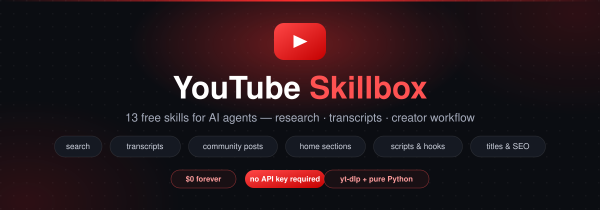

<div align="center">
  
</div>

<h1 align="center">YouTube Skillbox</h1>

<p align="center">
  <b>13 free YouTube skills for AI agents — research, transcripts, and the full creator workflow.</b><br>
  No API key · no credits · no expiry — <b>$0 forever</b>
</p>

<p align="center">
  <a href="#-the-youtube-research-skill">Research</a> ·
  <a href="#-the-transcript-skill">Transcripts</a> ·
  <a href="#-when-yt-dlp-cant-do-it-we-build-it">Gap-fill engine</a> ·
  <a href="#%EF%B8%8F-the-11-creator-skills">Creator tools</a> ·
  <a href="#-install">Install</a>
</p>

---

## What is this?

A drop-in set of **[SKILL.md](https://github.com/anthropics/skills) skills** for agent harnesses like **OpenCode** (works anywhere skills are discovered from a folder). Each skill in [`skills/`](skills/) is self-contained: a `SKILL.md` the agent reads, plus small Python tools it runs.

Two layers:

| Layer | Skills | Powered by |
| ----- | ------ | ---------- |
| **Data** (research) | `youtube`, `transcript` | `yt-dlp` + custom raw YouTube scrapers |
| **Creator workflow** | 11 × `yt-*` | local Python scripts, zero network deps for logic |

Everything is free. There is **no paid tier, no API key, and no account** anywhere in the stack.

---

## 📺 The `youtube` research skill

Ten subcommands behind one script — `skills/youtube/scripts/ytdata.py`:

```bash
python scripts/ytdata.py search "query" --limit 10     # find videos on a topic
python scripts/ytdata.py profile "@handle"             # About: subs, description, keywords
python scripts/ytdata.py sections "@handle"            # count EVERY tab at once
python scripts/ytdata.py home "@handle"                # home shelves + Featured Channels
python scripts/ytdata.py channel "@handle" --tab shorts
python scripts/ytdata.py latest "@handle" --limit 10
python scripts/ytdata.py posts "@handle" --limit 30    # community posts, paginated
python scripts/ytdata.py shows "@handle"               # Shows tab (episode collections)
python scripts/ytdata.py playlist "<playlist-url>"
python scripts/ytdata.py info "<video-url-or-id>"      # views, likes, tags, date
```

Add `--json` to any command for structured output. Example:

```
$ python scripts/ytdata.py sections "@MrBeast"
Channel: https://www.youtube.com/@MrBeast
  videos   : 805
  shorts   : 205
  streams  : no tab
  shows    : 3
  playlists: no tab
  community: 20+ posts (use `posts` to read them)
```

| Command | Returns |
| ------- | ------- |
| `search` | Videos matching a query — title, duration, views, channel, URL |
| `profile` | Channel About section — name, handle, subs, description, **all** keywords |
| `sections` | One-call counts of every tab: videos / shorts / streams / shows / playlists / posts |
| `home` | Home-tab shelves — featured video, Shorts, playlists, posts, **Featured Channels** (names + URLs) |
| `channel` | Channel uploads (`--tab videos \| shorts \| streams`) |
| `latest` | Most recent uploads, reverse-chronological |
| `posts` | Community posts — text, author, date, like count, URL. **Paginated** (~10/page) |
| `shows` | Shows tab — title, episode count, URL |
| `playlist` | Every video in a playlist |
| `info` | One video's exact stats — views, likes, subs, date, tags, categories, description |

---

## 📜 The `transcript` skill

Spoken text of any video, free via yt-dlp:

```bash
python scripts/gettranscript.py "<url-or-id>"                    # clean text
python scripts/gettranscript.py "<url-or-id>" --format stamped   # [MM:SS] per line
python scripts/gettranscript.py "<url-or-id>" --format json      # segments + metadata
python scripts/gettranscript.py "<url-or-id>" --lang es,es-419   # language priority list
```

Prefers human captions, falls back to auto-generated. The JSON form carries `start`/`duration` per cue — ready for chapters, quotes, or edit lists.

---

## 🛠 When yt-dlp can't do it, we build it

`yt-dlp` is the data engine for search, channels, playlists, metadata and transcripts — but it explicitly refuses a few things (returns `0 entries` or `"no home tab"`). Rather than pay an API, each gap is filled with **a small pure-Python scraper** (`urllib` + JSON parsing of YouTube's own page data / Innertube endpoints):

| Gap | What yt-dlp does | Our fill |
| --- | ---------------- | -------- |
| **Community posts** | `/community` → `0 entries` (wontfix) | Raw `ytInitialData` scrape of `/posts` (with `/community` fallback) |
| **Post pagination** | — | **Innertube `browse` continuation POSTs** — the exact request infinite-scroll fires when you scroll. `--limit 30` reaches ~3 pages / months back |
| **Home sections** | `"This channel does not have a home tab"` | Home-tab shelf parser: featured video, Shorts, playlists, posts, and **Featured Channels** with URLs |
| **Shows tab** | `0 entries` (can't parse `gridShowRenderer`) | Direct renderer parser → title, episode count, show URL |
| **Tab counts** | one tab per invocation | `sections` probes every tab and merges yt-dlp + raw results |

All of it is dependency-free Python — no API key, no credits, no tokens to manage.

```
$ python scripts/ytdata.py home "@MKBHD" --limit 3
  1. [featured video] Macbook PROLED XDR Impressions: ...  (1 item)
  2. [videos] Videos  (12 items)
  3. [featured channels] 🔥 MKBHD Approved 🔥  (6 items)
       - The Studio      https://www.youtube.com/channel/UCG7J20...
       - Auto Focus      https://www.youtube.com/channel/UC2J-0g...
       - WVFRM Podcast   https://www.youtube.com/channel/UCEcrRX...
```

---

## ✂️ The 11 creator skills

Local tools that turn raw transcripts/data into publishing artifacts:

| Skill | Does |
| ----- | ---- |
| `yt-script` | Full video script from a raw idea — 21 hook formulas, scored |
| `yt-package` | Title + thumbnail text written and linted as one pairing |
| `yt-seo` | Description, tags and search-facing text aimed at real queries |
| `yt-chapters` | Validated YouTube chapters straight from a transcript |
| `yt-shorts` | Finds the self-contained Shorts hiding inside a long video |
| `yt-edit` | Transcript → edit decision list (dead air, fillers, retakes) |
| `yt-retention` | Reads a Studio retention export, says where viewers leave |
| `yt-audit` | End-to-end channel audit — packaging, consistency, first 15s |
| `yt-viral` | What's actually working in a niche, ranked by channel-beat |
| `yt-plan` | A week/month content calendar sized to real capacity |
| `yt-comment` | Drafts comment replies in the creator's voice, triaged |

They pair naturally with the data layer: `youtube` finds the videos → `transcript` pulls the text → `yt-*` does the work.

---

## 📦 Install

**Requirements:** Python 3.10+ and [`yt-dlp`](https://github.com/yt-dlp/yt-dlp):

```bash
python -m pip install --user -U yt-dlp
```

> `posts`, `home` and `shows` work even *without* yt-dlp (pure HTTP). Everything else runs through it. Run it as a module (`python -m yt_dlp`) if the exe isn't on PATH.

Then, from this repo:

```bash
./install.sh                       # Linux / macOS → ~/.config/opencode/skills
```

```powershell
.\install.ps1                      # Windows → %USERPROFILE%\.config\opencode\skills
```

…or by hand — copy any folder from [`skills/`](skills/) into your agent's skills directory:

```bash
cp -r skills/* ~/.config/opencode/skills/
```

Restart the agent session; the skills are auto-discovered by their `description` frontmatter.

---

## 📝 Notes & limits

- YouTube may throttle (HTTP 429) if you hammer it — a small delay between bulk calls is enough.
- `posts` costs one HTTP request per ~10 posts; keep `--limit` ≤ 100 per invocation.
- `sections` shows `N+` for community counts when more pages exist (exact when they fit on page 1).
- Flat list view counts can show `?` occasionally — use `info` on a specific video for exact numbers.
- Private / age-restricted / deleted targets fail with a clear message instead of silence.

## 🙏 Credits

- **[yt-dlp](https://github.com/yt-dlp/yt-dlp)** — the extraction engine underneath the data layer.
- The creator (`yt-*`) skills were distilled from community OpenCode skill collections and reworked here.
- This project reads publicly available YouTube data; use it responsibly and respect YouTube's Terms of Service.

<p align="center">Made so nobody has to pay for a YouTube API key again 🎉</p>
